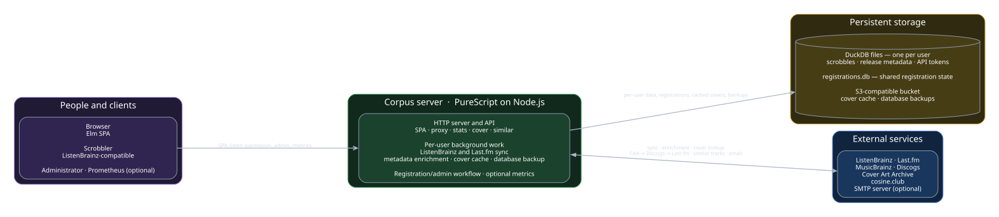

# Corpus architecture

Corpus is a self-hosted listening history dashboard. It synchronises ListenBrainz and Last.fm scrobbles for multiple users.

## System components

### Web server
The PureScript server runs on Node.js. It:

- serves the frontend, scrobble data, statistics and similar tracks from [cosine.club](https://cosine.club)
- accepts ListenBrainz-compatible scrobble submissions
- polls ListenBrainz and Last.fm every 60 seconds
- backfills Last.fm history older than the oldest stored scrobble
- deduplicates matching timestamps using the `listened_at` primary key
- enriches missing genres, labels and release years from MusicBrainz, Last.fm and Discogs
- redirects and caches cover art, trying Cover Art Archive, Discogs and then Last.fm
- provides optional registration, administration, email and Prometheus metrics

External API requests time out after 10 seconds. Image requests time out after 20 seconds. Corpus retries temporary sync failures up to 5 times, waiting longer each time. It does not retry responses it cannot parse.

### Frontend
The Elm single-page application:

- refreshes the scrobble list every 30 seconds
- filters by artist, album, track, label, genre or release year
- searches tracks, artists, albums and labels
- links listen metadata to matching filters
- shows listening statistics
- provides the registration and administration pages
- works on desktop and mobile

### Database
Corpus stores each user's data in a separate DuckDB file:

- `scrobbles` stores listening history with `listened_at` as its primary key
- `release_metadata` stores genre, label and release year by MusicBrainz release ID
- `api_tokens` stores SHA-256 hashes of submission tokens

A shared DuckDB file, `registrations.db`, stores pending, approved, denied and revoked registrations.

DuckDB's columnar storage supports analytical queries over large listening histories. See [DuckDB in Corpus](duckdb.md) for the full schema.

### Storage
Corpus uses an S3-compatible bucket when you enable cover caching or backups:

- the cover cache stores AVIF images under `covers/<source>/` and redirects hits to presigned S3 URLs that expire after 24 hours
- backups checkpoint a user's DuckDB file and upload timestamped snapshots under `backups/`

## Multi-user support

Corpus serves multiple users from one process. Each user is either:

- a static user, defined in `users.json` and managed through the command-line interface
- a registered user, created when an administrator approves a registration

### Routes

Corpus provides these routes:

- `/` and `/u/<slug>`: serve the Elm application for the root user and named users
- `/proxy?user=<slug>`, `/stats?user=<slug>`, `/cover?user=<slug>`, `/similar?user=<slug>`: select a user through the query parameter
- `/healthz?user=<slug>`: checks the user's DuckDB connection
- `/1/validate-token`: validates a ListenBrainz-compatible token
- `/1/submit-listens`: accepts ListenBrainz-compatible submissions with an `Authorization: Token <token>` header
- `/register`: serves the registration page, and accepts registration requests as `POST`
- `/admin`: serves the administration page
- `/admin/registrations`, `/admin/registrations/approve`, `/admin/registrations/deny`: list, approve and deny pending registrations
- `/admin/users` and `/admin/users/remove`: list and remove registered users
- `/metrics`: returns metrics for all users when `METRICS_ENABLED=true`

Set `REGISTRATION_ENABLED=true` to enable registration. Set `ADMIN_TOKEN` to enable the `/admin/*` APIs. Send the token as `Authorization: Bearer <token>`.

### User management

Stop Corpus before using these commands to change `users.json`:

```sh
# Add a new user (creates the DB, prints the API token once)
node server.js add-user --slug filip --name "Filip" --db filip.db

# Optional: link a ListenBrainz or Last.fm account at creation time
node server.js add-user --slug filip --name "Filip" --db filip.db \
  --listenbrainz-user filip --lastfm-user filiplfm

# List all users
node server.js list-users

# Regenerate the API token for a user
node server.js reset-token --slug filip
```

The `just add-user`, `just list-users` and `just reset-token` recipes run the same commands.

Corpus prints the API token once when you create or reset a user. Store it securely. Send it to `/1/submit-listens` as `Authorization: Token <token>`.

### Configuration
User configuration has 2 layers:

1. `users.json` defines user slugs, source usernames, database filenames and feature flags. The CLI manages this file. Corpus reads it at startup from `CORPUS_USERS_FILE`, which defaults to `users.json`.
2. Environment variables provide shared API keys and S3 credentials at runtime. Corpus also loads them from a `.env` file.

Each user has a separate DuckDB connection, sync loop and write lock. The lock runs ListenBrainz and Last.fm sync transactions in sequence. HTTP reads use DuckDB snapshots without taking the lock.

### Registration

When registration is enabled:

1. A visitor submits a username, name and email address at `/register`. They can also add ListenBrainz and Last.fm usernames.
2. Corpus rejects usernames that are taken, reserved for a route, or not made of lowercase letters, numbers and dashes.
3. Corpus stores the request as pending and emails `ADMIN_EMAIL`, if set.
4. An administrator approves or denies the request at `/admin`.
5. On approval, Corpus creates `corpus-<slug>.db` in `DATABASE_PATH`, starts the user's background work and returns their API token. It also emails the token to the user.
6. On denial, Corpus emails the user.

Registered users have cover caching and backups turned off.

Corpus reloads approved registrations from `registrations.db` at startup. It does not change `users.json`. A `users.json` entry takes precedence over a registration with the same slug.

Corpus sends email only when `SMTP_HOST` is set. If sending fails, Corpus logs the error and continues.

### Remove registered users

An administrator can remove a self-registered user without restarting Corpus. Corpus stops their background work, closes and deletes their DuckDB file, then revokes the registration. Administrators cannot use this process for users defined in `users.json`.

## Configuration reference

### Environment variables

| Variable | Default | Purpose |
|---|---|---|
| `CORPUS_USERS_FILE` | `users.json` | Path to the user configuration file |
| `DATABASE_PATH` | current directory | Directory for all user database files |
| `LASTFM_API_KEY` | not set | Last.fm API key for sync, genre and cover fallbacks |
| `DISCOGS_TOKEN` | not set | Discogs token for genre and cover fallbacks |
| `S3_BUCKET` | not set | S3 bucket for cover caching and backups |
| `S3_REGION` | `us-east-1` | S3 region |
| `AWS_ACCESS_KEY_ID` | not set | S3 credentials |
| `AWS_SECRET_ACCESS_KEY` | not set | S3 credentials |
| `AWS_ENDPOINT_URL` | not set | S3-compatible endpoint |
| `AWS_S3_ADDRESSING_STYLE` | not set | `virtual` or `path` |
| `COSINE_API_KEY` | not set | [cosine.club](https://cosine.club) API key for similar tracks |
| `PORT` | `8000` | HTTP listen port |
| `HOST` | `127.0.0.1` | HTTP listen host |
| `METRICS_ENABLED` | `false` | Set to `true` to enable `/metrics` |
| `CORS_ORIGIN` | `*` | Value of `Access-Control-Allow-Origin` on `/proxy` responses |
| `REGISTRATION_ENABLED` | `false` | Set to `true` to enable public registration at `/register` |
| `ADMIN_TOKEN` | not set | Bearer token for `/admin/*`; these routes return 404 when unset |
| `ADMIN_EMAIL` | not set | Address notified of new registration requests |
| `CORPUS_REGISTRATIONS_DB` | `registrations.db` | Shared DuckDB file for registration state, relative to `DATABASE_PATH` |
| `SMTP_HOST` | not set | SMTP server host; Corpus skips email when unset |
| `SMTP_PORT` | `587` | SMTP port (STARTTLS) |
| `SMTP_USER` | not set | SMTP username |
| `SMTP_PASS` | not set | SMTP password |
| `SMTP_FROM` | `SMTP_USER` | Sender address |

Corpus does not start if a user needs a variable that is not set:

- any user with `lastfmUser` needs `LASTFM_API_KEY`
- any user with `coverCacheEnabled` or `backupEnabled` needs `S3_BUCKET`, `AWS_ACCESS_KEY_ID`, `AWS_SECRET_ACCESS_KEY` and `AWS_ENDPOINT_URL`

### `users.json` fields

`slug` and `name` belong to each item in `users`. Put the other fields in its `config` object. Only `name`, `listenbrainzUser` and `lastfmUser` are optional.

| Field | Type | Purpose |
|---|---|---|
| `slug` | string | URL slug (`""` for the root user, `"filip"` for `/u/filip`) |
| `name` | optional string | Display name, which defaults to the slug |
| `listenbrainzUser` | optional string | ListenBrainz username |
| `lastfmUser` | optional string | Last.fm username |
| `databaseFile` | string | DuckDB filename, relative to `DATABASE_PATH` |
| `coverCacheEnabled` | boolean | Enables S3 cover caching |
| `backupEnabled` | boolean | Enables periodic S3 database backups |
| `backupIntervalHours` | integer | Hours between backups |

## Data flow

### Scrobble synchronisation

Corpus syncs each user once at startup, then every 60 seconds. Both sync processes fetch the newest page, insert new scrobbles and move backwards until they find a known timestamp.

ListenBrainz uses timestamp-based pagination:
1. Fetch the latest 100 scrobbles from the ListenBrainz API.
2. Insert new scrobbles. Stop if an existing timestamp is found.
3. Page backwards using `max_ts` until caught up.

Last.fm uses page-based pagination:
1. Fetch page 1 (the most recent 200 scrobbles) from the Last.fm API.
2. Insert new scrobbles. Stop if an existing timestamp is found.
3. Page through later pages using `totalPages` from the API response until caught up.
4. Request scrobbles older than the oldest stored scrobble, and insert any it finds.

The last step imports older Last.fm history, for example from before a user started using ListenBrainz.

### Metadata enrichment

Corpus enriches up to 10 releases without metadata and 10 releases without a genre at a time:

1. Corpus requests release details from MusicBrainz, one request every 1.1 seconds.
2. If MusicBrainz has no genre, it tries Last.fm and then Discogs.
3. It updates `release_metadata` with any details found.
4. If no source has a genre, it records the time in `genre_checked_at` and tries again after 7 days.

If a MusicBrainz request fails, Corpus tries the release again in the next batch. When no releases need enrichment, Corpus waits 60 seconds before checking again.

### Cover art retrieval
When a client requests a cover, Corpus tries these sources in order:

1. Cover Art Archive, if the scrobble has a release MBID.
2. Discogs, if `DISCOGS_TOKEN` is set.
3. Last.fm, if `LASTFM_API_KEY` is set.

For each source, Corpus checks the S3 cache first, then asks the source. It redirects the client to the first image it finds.

If caching is enabled, Corpus converts the image to AVIF and uploads it in the background. It skips images larger than 10 MB and fills at most 4 cache entries at a time.

## Observability

### Prometheus metrics

Prometheus metrics are disabled by default. Set `METRICS_ENABLED=true` to record HTTP requests and background work. When disabled, `/metrics` returns 404 and metric calls do nothing.

| Metric | Type | Labels | Description |
|---|---|---|---|
| `corpus_http_requests_total` | Counter | `method`, `path`, `status` | HTTP requests |
| `corpus_http_request_duration_seconds` | Histogram | `method`, `path` | HTTP request latency |
| `corpus_sync_runs_total` | Counter | `user`, `source`, `result` | Sync loop iterations |
| `corpus_sync_scrobbles_added_total` | Counter | `user`, `source` | Scrobbles inserted per sync |
| `corpus_sync_last_success_seconds` | Gauge | `user`, `source` | Timestamp of last successful sync |
| `corpus_enrichment_fetches_total` | Counter | `user`, `source`, `result` | Metadata enrichment API calls |
| `corpus_enrichment_queue_size` | Gauge | `user`, `type` | Releases pending enrichment |
| `corpus_cover_requests_total` | Counter | `user`, `source`, `result` | Cover art requests |
| `corpus_cosine_requests_total` | Counter | `user`, `result` | Similar-track lookup requests |
| `corpus_db_backup_runs_total` | Counter | `user`, `result` | Database backup runs |
| `corpus_db_backup_last_success_seconds` | Gauge | `user` | Timestamp of last successful backup |

`@prometheus-io/client` also collects Node.js garbage collection, event loop and memory metrics.

## Tech stack

- server language: [PureScript](https://purescript.org)
- frontend language: [Elm](https://elm-lang.org)
- runtime: [Node.js](https://nodejs.org)
- database: [DuckDB](https://duckdb.org), with one file for each user
- configuration: JSON in `users.json`, managed through the command-line interface
- bundling: [Spago](https://github.com/purescript/spago), [esbuild](https://esbuild.github.io/) and [elm make](https://guide.elm-lang.org/install/elm.html)
- build environment: [Nix](https://nixos.org)

## Foreign function interface

Corpus uses JavaScript modules where no PureScript wrapper is available:

- `Db.js` uses `@duckdb/node-api`, converts JavaScript `BigInt` values to `Number` for JSON and hashes tokens with SHA-256
- `S3.js` uses `@aws-sdk/client-s3` to upload covers and backups, and to create presigned cover URLs
- `Image.js` uses `sharp` to convert covers to AVIF
- `Cover.js` limits how many covers Corpus caches at the same time
- `Mail.js` uses `nodemailer` to send registration emails
- `Metrics.js` uses `@prometheus-io/client` to record HTTP and background-work metrics
- `Config.js` reads and parses the file set by `CORPUS_USERS_FILE`
- `Command.js` formats `users.json` when the CLI writes it
- `Main.js` loads `.env` files

## System flow

See the [system flow diagram source](architecture.dot). Render it with `just docs`.


